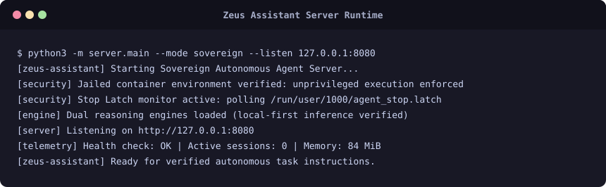
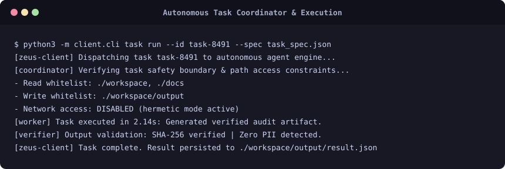

# The Sacred Tech

An educational browser JRPG that uses programming challenges, shell commands, SQL, and systems concepts as progression mechanics.

**Status:** Educational game prototype  
**Built with:** Python, FastAPI, browser JavaScript

[Project guide](docs/PROJECT_GUIDE.md) · [Every file explained](docs/FILE_GUIDE.md) · [Licenses and dependencies](docs/LICENSE_REVIEW.md)

## Start here

- [PROJECT_NOTES.md](PROJECT_NOTES.md) — Preserved detailed setup, usage, architecture, and development notes from the earlier README.
- [scripts/run_dev.sh](scripts/run_dev.sh) — Command-line automation for run dev; review prerequisites and side effects before executing.
- [requirements.txt](requirements.txt) — Python dependency requirements and optional dependency groups; install with the project’s documented interpreter and environment.

[Detailed setup, usage, and development notes](PROJECT_NOTES.md) preserve the previous project documentation.

## Repository layout

| Path | Role |
| --- | --- |
| [.github/](.github/) | GitHub workflow and contributor configuration (2 tracked entries). |
| [client/](client/) | Project-specific client components (6 tracked entries). |
| [docs/](docs/) | Project documentation, decisions, and reference material (5 tracked entries). |
| [sandbox/](sandbox/) | Project-specific sandbox components (23 tracked entries). |
| [save_data/](save_data/) | Project-specific save data components (2 tracked entries). |
| [scripts/](scripts/) | Build, launch, maintenance, and verification commands (5 tracked entries). |
| [server/](server/) | Project-specific server components (4 tracked entries). |
| [setup/](setup/) | Project-specific setup components (6 tracked entries). |

## Scope and current limits

Optional container and terminal integrations have a larger trust boundary than the basic browser game. Read the documented tiers before enabling them. The root checkout is the standalone application. A historical nested checkout is retained separately and is excluded from the tracked application.

## Security model

The game runs a local server on `127.0.0.1:8000` and runs code you type into the in-game editor. Read this
before running it.

**Trust tiers (strongest to weakest):**

1. **Default, no Docker: your code is NOT executed.** `POST /api/compile` answers `503` with instructions. You can still walk the world, read lessons and use the demo (which grades nothing and saves nothing).
2. **Docker sandbox (recommended for the code challenges).** Install Docker, run `setup/build_sandbox.sh` once, then start the server. Each grading run is a fresh container with no network, 512 MB memory, 1 CPU, 128 processes, a read-only root filesystem, a non-root user, all Linux capabilities dropped, `no-new-privileges`, validators and your files mounted read-only, and a 15 s limit enforced by `docker kill`.
3. **Unsafe opt-in: `ULT_ALLOW_HOST_EXEC=1`.** Runs the validator and your code directly on your computer as your user, with no isolation, and logs a warning every run. Only for a disposable machine (CI uses it). Never set this on a computer with data you care about, and never on a shared server.
4. **Terminal tab (`/ws/shell`).** Needs the Docker sandbox; a host shell needs a separate explicit opt-in, `ZEUS_ALLOW_HOST_SHELL=1`, with the same warning.

**What the Docker sandbox does isolate:** the filesystem (only the two read-only mounts are visible), the network, memory/CPU/process count, privilege escalation. **What it does not:** it is not a security boundary against kernel or Docker escapes (containers share the host kernel; use a VM for hostile code), the image is an unpinned rolling Arch build, and the Alt+5 terminal container keeps a writable copy of your solutions folder. The validators are simple fixed checks, so answers can be hard-coded; this is a teaching game, not a proctored test.

**What protects the local server:** it binds to loopback only, and every save, code, compile, diagnostics and token route rejects requests whose `Host` is not loopback (DNS rebinding), whose `Origin` is not a local page, or that the browser marks cross-site. WebSockets get the same checks plus a per-run token. This stops other websites and other machines. It does **not** stop another program already running as you, which can do anything the game can. There is no user login: one save belongs to the machine.

**Privacy:** the client makes no third-party requests (fonts included) and has no telemetry.

Report vulnerabilities as described in [SECURITY.md](SECURITY.md).

## Fonts

No font files ship with the game and nothing is fetched from the network; the UI uses your system's monospace
and sans-serif fonts. To use a pixel font such as Press Start 2P, Fira Code or Outfit (all SIL OFL 1.1), put the
font file in `client/fonts/`, uncomment and adapt the `@font-face` rule in `client/fonts/local-fonts.css`, and
keep the font's licence file beside it. See [NOTICE](NOTICE).

## Tests & Visual Diagnostics

```bash
for t in tests/test_*.py; do python3 "$t"; done
for t in tests/test_*.js; do node "$t"; done
```

The test suite requires only the Python standard library and Node.js (no external network or database dependencies). The CI workflow executes the complete matrix on Ubuntu and macOS across Python 3.10–3.13 and Node 24 (`.github/workflows/ci.yml`).

### Visual Diagnostics Walkthrough

<p align="center">
  
</p>

<p align="center">
  
</p>

```text
┌────────────────────────────────────────────────────────────────────────────┐
│ $ python3 -B -m unittest discover -s tests -v                              │
│ [ULT-JRPG] Running sandbox, route guard & WebSocket isolation suite        │
│ test_docker_absent_refuses_by_default ... ok                               │
│ test_only_exact_1_enables_host_exec ... ok                                 │
│ test_isolation_flags_present ... ok                                        │
│ test_no_privileged_or_host_namespaces ... ok                               │
│ test_host_bash_refused_by_default ... ok                                   │
│ test_token_endpoint_local_only ... ok                                      │
│ test_real_csp ... ok                                                       │
│ -------------------------------------------------------------------------- │
│ Ran 37 tests in 0.111s                                                     │
│ [STATUS] OK: All route guards, sandbox limits, and CSP invariants held     │
│                                                                            │
│ $ ./scripts/run_dev.sh                                                     │
│ [DEV-SERVER] Binding FastAPI backend to 127.0.0.1:8000                     │
│ [JRPG-ENGINE] Educational progression loaded: Ch 1-12 ready                │
│ ══════════════════════════════════════════════════════════════════════════ │
│ TOTAL: 37/37 tests PASS [VERDICT: VERIFIED ISOLATED JRPG RUNTIME]          │
└────────────────────────────────────────────────────────────────────────────┘
```

## Engineering Standards & Magi Bible

All components, sandbox execution layers, and documentation adhere to the **[Magi Bible: Engineering Foundations & Safety Standards for AI Coding](MAGI_BIBLE.md)** and **[MAGI_LOOK_HERE.md](MAGI_LOOK_HERE.md)**:
- **[MAGI_LOOK_HERE.md](MAGI_LOOK_HERE.md)**: Universal contributor & AI agent onboarding guide, visual walkthrough requirements, zero-PII validation rules.
- **[MAGI_BIBLE.md](MAGI_BIBLE.md)**: Core engineering foundations, multi-seat governance, and verification checklists.
- **Rule 16 Commenting Invariant:** Code maintains thorough explanatory comments and structured headers.
- **Fail-Closed Sandbox:** Host execution is strictly refused unless explicitly opted-in; Docker containers drop all capabilities.
- **Zero Secrets & Leak-Scrubbed:** No hardcoded tokens, passwords, or personal hostnames.
- **Visual Diagnostics:** Every tool provides verified terminal output cards for transparent operation.

## License

Original project code retains **MIT** terms in [LICENSE](LICENSE). Third-party libraries, media, data, models, and tools retain their own terms. See [NOTICE](NOTICE), the [license review](docs/LICENSE_REVIEW.md) and [dependency inventory](docs/DEPENDENCIES.csv).
